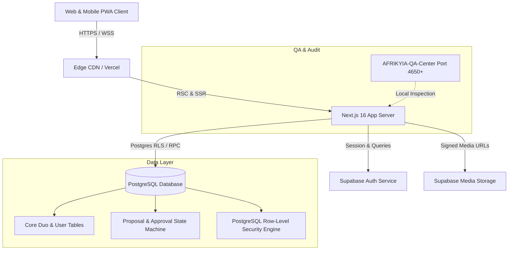

# MYHALF — System Architecture & Technical Design

## 1. High-Level System Architecture

MYHALF is engineered as a modern, reactive, mobile-first Web Application built on **Next.js 16 (App Router)** and **Supabase (Auth, PostgreSQL, Storage)**, designed for zero-trust authorization, strict equal ownership invariants, and seamless multi-language RTL/LTR rendering.



---

## 2. Technology Stack Selection & Rationales

| Layer | Technology | Version | Rationale |
|---|---|---|---|
| **Framework** | Next.js (App Router) | 16.x | Native React Server Components, server actions, nested routing, streaming SSR. |
| **UI Library** | React | 19.x | Concurrent rendering, Server Actions, modern form actions and optimistic hooks. |
| **Language** | TypeScript | 5.x (Strict) | Exhaustive type-safety, contract validation, eliminating runtime null pointer bugs. |
| **Styling** | Tailwind CSS | v4.x | CSS variables native tokens, zero-runtime overhead, dynamic RTL utility classes. |
| **Database & Auth** | Supabase / PostgreSQL | 16+ | Native Row Level Security (RLS), atomic transactions, JWT auth, realtime events. |
| **Schema Validation** | Zod | 3.x | Runtime payload validation for server actions, forms, and API routes. |
| **Unit & Component Testing** | Vitest + RTL | 4.x / 16.x | Fast ESM runner, React Testing Library, jest-dom matchers. |
| **End-to-End Testing** | Playwright | 1.4x | Isolated browser test automation on port 4650 with isolated dummy credentials. |
| **PWA** | Web App Manifest + SW | Standalone | Native-like mobile installation, offline shell, push notifications ready. |

---

## 3. Directory Layout & Module Structure

```text
myhalf/
├── .github/                 # CI workflows & actions
├── docs/                    # Architectural specs, plans, decisions, status
│   ├── plans/               # Implementation plans (YYYY-MM-DD-<slug>.md)
│   ├── PRODUCT_SPEC.md      # Product specifications
│   ├── ARCHITECTURE.md      # This document
│   ├── DATA_MODEL.md        # Database schemas, migrations, relations
│   ├── SECURITY_MODEL.md    # RLS policies, dual approvals, threat model
│   ├── DESIGN_SYSTEM.md     # Design tokens, typography, components
│   ├── TEST_STRATEGY.md     # TDD rules, test matrices, QA gate
│   ├── UX_FLOWS.md          # 16 UX screen specifications
│   ├── STATUS.md            # Overall project status
│   ├── DECISIONS.md         # Append-only architectural decisions
│   └── QA_REPORT.md         # Central QA execution log
├── public/                  # Static assets, icons, manifest.json
│   ├── locales/             # Localization JSON dictionaries (ar, fr, en)
│   └── icons/               # PWA icons and brand assets
├── src/
│   ├── app/                 # Next.js App Router routes
│   │   ├── [locale]/        # Locale-scoped routes (ar, fr, en)
│   │   │   ├── (auth)/      # Login, Register, Partner Invite
│   │   │   ├── (app)/       # Feed, Explore, Duo Profile, Create, Governance
│   │   │   ├── (admin)/     # Moderation dashboard
│   │   │   ├── layout.tsx   # Root localized layout with RTL/LTR dir
│   │   │   └── page.tsx     # Welcome landing page
│   │   ├── api/             # Webhook and background API routes
│   │   └── layout.tsx       # Root HTML container
│   ├── components/          # Reusable UI components
│   │   ├── ui/              # Buttons, inputs, modals, avatars, badges
│   │   ├── duo/             # Duo avatar, Duo header, Co-owner badges
│   │   ├── feed/            # Post card, Two-perspectives card, actions
│   │   ├── governance/      # Proposal cards, approval buttons, audit log
│   │   └── layout/          # Navigation bars, mobile bottom bar, header
│   ├── lib/                 # Core utilities
│   │   ├── supabase/        # Browser and Server Supabase clients
│   │   ├── i18n/            # Localization dictionary loaders and hooks
│   │   ├── validators/      # Zod validation schemas
│   │   ├── governance/      # Dual-approval calculation and proposal hashing
│   │   └── utils.ts         # Formatting, class merging, date utilities
│   └── types/               # TypeScript interfaces, database types, models
├── tests/                   # Test suits
│   ├── unit/                # Vitest unit tests (logic, governance, schemas)
│   ├── components/          # Vitest React Testing Library component tests
│   └── mocks/               # Mock Supabase client and test fixtures
├── e2e/                     # Playwright end-to-end integration tests
│   ├── isolated-env.ts      # Isolated environment guard (no live Supabase calls)
│   └── user-flows.spec.ts   # E2E test suites
├── vitest.config.ts         # Vitest configuration
├── playwright.config.ts     # Playwright configuration
├── package.json             # Scripts and dependencies
└── tsconfig.json            # Strict TypeScript configuration
```

---

## 4. Architectural Patterns & Guidelines

### 4.1. Server-Side Data Fetching & Row Level Security
- All sensitive operations execute on the server via Next.js Server Actions or Server Components.
- The PostgreSQL database enforces RLS for every incoming query using the authenticated JWT (`auth.uid()`).
- Data queries automatically restrict private user fields (such as private security settings or emergency freeze logs) to the individual owner, while exposing shared duo data to both authenticated owners.

### 4.2. Dual-Ownership Invariant Enforcement
- **Constraint Invariant:** Every active duo has `num_owners == 2`.
- When an account is created, it begins in `PENDING_PARTNER` state. It cannot post, follow, or be discovered publicly until the second owner accepts and verifies their identity.
- Disassociation / Disbanding requires either:
  1. Mutual dual-approval through the governance ledger.
  2. Unilateral emergency safety exit (which freezes the duo account and converts it to archived status to protect the exiting party).

### 4.3. Localization & Bidirectionality
- Routing follows `/[locale]/path` where locale is one of `ar`, `fr`, `en`.
- Root HTML sets `dir="rtl"` and `lang="ar"` for Arabic, and `dir="ltr"` for French and English.
- CSS layout relies on CSS logical properties (`margin-inline-start`, `inset-inline-end`, `border-inline-start`) and Tailwind v4 logical utilities (`ms-*`, `me-*`, `ps-*`, `pe-*`) ensuring 100% bug-free bidirectional UI.

### 4.4. Offline & PWA Architecture
- PWA manifest defines standalone display, theme color `#247B78`, and orientation preferences.
- Lightweight service worker caches static assets and shells while maintaining strict network-first policies on sensitive user and governance endpoints.
