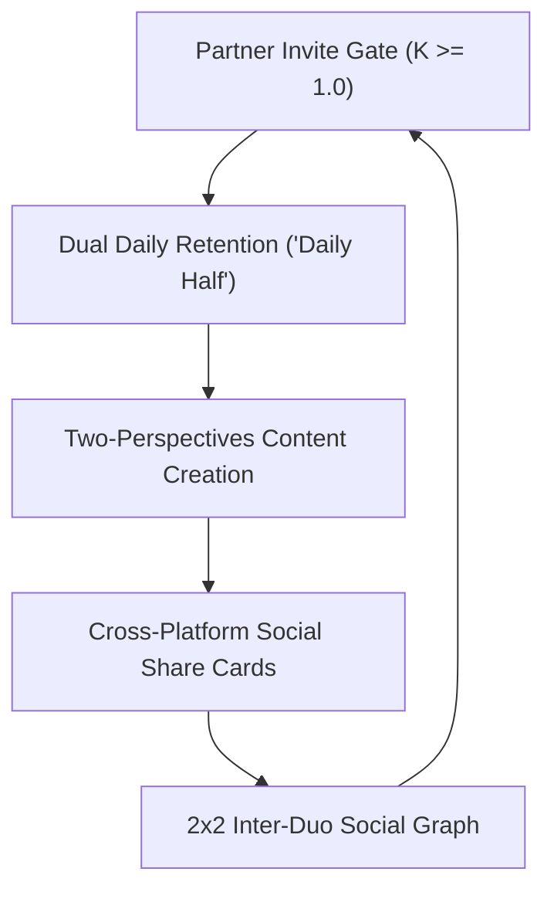

# MYHALF — Competitive Playbook & Global Network Strategy

> **"Two People. One Account. Equal Ownership."**  
> *Category Definition: The World's First Co-Owned Social Graph.*

---

## 1. The Executive Thesis: Why MYHALF Wins

Every incumbent social network (Instagram, TikTok, X, Snapchat, BeReal) was architected around a single, individualistic axiom:
$$\text{One Human} = \text{One Profile} = \text{One Ad Target}$$

Yet, the most meaningful milestones, memories, creative projects, and ventures in human life are experienced **together** — as couples, best friends, siblings, creative partners, and co-founders.

Today, pairs are forced to either:
1. Hack existing platforms by sharing single passwords (security vulnerability, zero privacy, asymmetric control).
2. Maintain separate individual profiles where one person's voice dominates or memories are fragmented.

**MYHALF is not just an app; it is a new social category.**  
By enforcing equal ownership, dual cryptographic governance, and dual perspectives at the foundational protocol layer, MYHALF constructs an unassailable defensive moat that single-user incumbent giants cannot copy without breaking their own legacy architectures.

---

## 2. The 4 Viral Growth Flywheels

### Flywheel 1: The Built-in 100% Viral Coefficient ($K \ge 1.0$)
In normal apps, user acquisition requires paid ads or artificial referral schemes.  
In **MYHALF**, a user *cannot* activate a public profile without inviting their co-owner.  
- **Result:** Every 1 user acquired organically acquires 1 additional high-intent, active user automatically. Organic acquisition costs (CAC) are effectively halved from day one.

### Flywheel 2: The "Daily Half" Blind Reveal Loop
Inspired by BeReal but supercharged with pairwise psychology:
- At a randomized time each day, both co-owners receive the Daily Half prompt (e.g., *"What surprised you most about each other this week?"*).
- **The Blind Privacy Guard:** Co-owner A cannot see Co-owner B's answer until Co-owner A submits their own.
- **The Notification Trigger:** *"Omar just answered today's Daily Half! Submit your answer now to unlock and reveal his response."*
- **The Duo Streak (Flame 🔥):** Daily streak increments only when both partners complete the prompt before midnight. Missing a day triggers mutual accountability.

### Flywheel 3: The Two-Perspectives Split Slider
- Audiences are tired of staged, one-sided Instagram posts.
- MYHALF's 50/50 Split Post allows followers to drag an interactive slider and see both angles of the exact same moment:
  - *Partner 1's View:* Preparing behind the scenes / Candid emotion.
  - *Partner 2's View:* The final outcome / Alternative reaction.
- High curiosity drives followers to share the split post externally to TikTok and Instagram Stories, directing new traffic back to `https://myhalf.online`.

### Flywheel 4: 2x2 Duo Chat Hub
- Instead of single DMs or chaotic group chats, duos message other duos.
- Features:
  - **Voice Attribution:** Speak as Omar, speak as Sarah, or toggle to the **Unified Duo Voice**.
  - **Private Co-Owner Backchannel (Whisper Mode):** Inside any ongoing conversation with another duo, Omar and Sarah have a private, encrypted side-channel visible only to the two of them to confer before replying publicly.

---

## 3. High-Conversion Acquisition & Retention Mechanics

| Feature | Incumbents (Instagram/TikTok) | MYHALF Competitive Edge |
| :--- | :--- | :--- |
| **Account Ownership** | 1 individual owner; password sharing risky | Cryptographically equal dual ownership with independent logins |
| **Sensitive Actions** | Unilateral edit or account deletion | Nonce-bound dual approval requirement (Replay-safe) |
| **Safety Invariant** | Account hostage situations during conflict | Unilateral emergency freeze & confidential abuse reporting |
| **Daily Habit Loop** | Endless passive algorithmic doom-scrolling | Active pairwise intimacy ("Daily Half" blind reveal) |
| **Identity Presentation** | Single ego curation | Balanced dual avatar system with zero visual hierarchy |
| **Language Inclusivity** | English/LTR-first with clumsy translations | Native trilingual engine (Arabic RTL Cairo, French/English LTR) |

---

## 4. Monetization Model (Duo Economics)

1. **MYHALF Duo Pro ($4.99/mo or $39.99/yr per Duo):**
   - Unlimited high-resolution Memory Vault storage.
   - Custom animated duo profile borders & flame streak protections.
   - Dual voice notes and audio story highlights.
2. **Vanity Duo Handles:**
   - Auction and sale of premier 2-4 letter duo handles (e.g., `@we`, `@us`, `@om_sa`).
3. **Physical NFC Duo Keycards & VIP Passes:**
   - Physical laser-etched metal or matte cards with embedded NFC chip that opens `https://myhalf.online/@handle` on any smartphone.
4. **Partner Brand Collaborations:**
   - Incumbents do not have ad infrastructure for joint sponsorship deals. Brands want to sponsor pairs (running partners, culinary duos, travel couples, co-founders). MYHALF provides verified dual-signoff analytics for brands.

---

## 5. Security & Safety as a Core Differentiator

Unlike general social platforms where relationship conflict often leads to revenge leaks or locked accounts:
- **Zero-Trust Multi-Principal Architecture:** Both partners hold distinct private authentication credentials. Neither can see or reset the other's private password.
- **Unilateral Safety Freeze:** Any co-owner who feels coerced, threatened, or detects unauthorized activity can trigger an instantaneous emergency freeze without the other co-owner's consent.
- **Confidential Reporting:** Abuse reports filed by one partner are completely invisible to the other partner, guaranteeing real-world victim protection.

---

## 6. Global Domain & Infrastructure Deployment

- **Production Canonical Domain:** `https://myhalf.online`
- **Global Edge Network:** Vercel Global Edge (<50ms TTFB across Europe, Middle East, Africa, and Americas).
- **PWA Ready:** Native home-screen installability, offline service worker caching, Web Audio synthesized tactile feedback.
