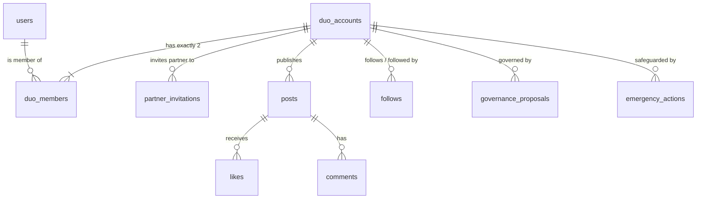

# MYHALF — Data Model & Schema Specification

## 1. Relational Entity Overview

The MYHALF data model is designed around two distinct foundational entities:
1. **Private Identity (`users`):** Represents an individual human account holder with private credentials and individual settings.
2. **Shared Public Identity (`duo_accounts`):** Represents the co-owned public social entity. All public content, follows, and interactions occur at this level.



---

## 2. PostgreSQL Schema Definitions

### 2.1. Private Users (`public.users`)
Stores private profile information. Never exposed in public directory searches.
```sql
CREATE TABLE public.users (
    id UUID PRIMARY KEY REFERENCES auth.users(id) ON DELETE CASCADE,
    email TEXT NOT NULL UNIQUE,
    full_name TEXT NOT NULL,
    display_name TEXT NOT NULL,
    avatar_url TEXT,
    preferred_locale TEXT NOT NULL DEFAULT 'en' CHECK (preferred_locale IN ('ar', 'fr', 'en')),
    is_verified BOOLEAN NOT NULL DEFAULT FALSE,
    emergency_contact_email TEXT,
    created_at TIMESTAMPTZ NOT NULL DEFAULT NOW(),
    updated_at TIMESTAMPTZ NOT NULL DEFAULT NOW()
);
```

### 2.2. Duo Accounts (`public.duo_accounts`)
The core social entity visible to the public.
```sql
CREATE TYPE duo_status AS ENUM ('PENDING_PARTNER', 'ACTIVE', 'FROZEN', 'ARCHIVED');
CREATE TYPE duo_privacy AS ENUM ('PUBLIC', 'PRIVATE');

CREATE TABLE public.duo_accounts (
    id UUID PRIMARY KEY DEFAULT gen_random_uuid(),
    handle TEXT NOT NULL UNIQUE CHECK (handle ~ '^[a-z0-9_]{3,30}$'),
    display_name TEXT NOT NULL CHECK (char_length(display_name) <= 60),
    bio TEXT CHECK (char_length(bio) <= 300),
    avatar_url TEXT,
    header_url TEXT,
    status duo_status NOT NULL DEFAULT 'PENDING_PARTNER',
    privacy duo_privacy NOT NULL DEFAULT 'PUBLIC',
    archetype TEXT DEFAULT 'duo', -- 'creative', 'friends', 'partners', 'siblings', etc.
    verified_at TIMESTAMPTZ,
    frozen_at TIMESTAMPTZ,
    frozen_reason TEXT,
    created_at TIMESTAMPTZ NOT NULL DEFAULT NOW(),
    updated_at TIMESTAMPTZ NOT NULL DEFAULT NOW()
);
```

### 2.3. Duo Members (`public.duo_members`)
Associates exactly two verified users with one shared duo account.
```sql
CREATE TYPE member_status AS ENUM ('PENDING', 'ACTIVE', 'SUSPENDED');

CREATE TABLE public.duo_members (
    id UUID PRIMARY KEY DEFAULT gen_random_uuid(),
    duo_id UUID NOT NULL REFERENCES public.duo_accounts(id) ON DELETE CASCADE,
    user_id UUID NOT NULL REFERENCES public.users(id) ON DELETE CASCADE,
    role TEXT NOT NULL DEFAULT 'CO_OWNER' CHECK (role = 'CO_OWNER'),
    status member_status NOT NULL DEFAULT 'ACTIVE',
    owner_slot INT NOT NULL CHECK (owner_slot IN (1, 2)),
    joined_at TIMESTAMPTZ NOT NULL DEFAULT NOW(),
    UNIQUE (duo_id, user_id),
    UNIQUE (duo_id, owner_slot)
);
```

### 2.4. Partner Invitations (`public.partner_invitations`)
Manages cryptographic partner invitation workflows.
```sql
CREATE TYPE invitation_status AS ENUM ('PENDING', 'ACCEPTED', 'REVOKED', 'EXPIRED');

CREATE TABLE public.partner_invitations (
    id UUID PRIMARY KEY DEFAULT gen_random_uuid(),
    duo_id UUID NOT NULL REFERENCES public.duo_accounts(id) ON DELETE CASCADE,
    inviter_user_id UUID NOT NULL REFERENCES public.users(id) ON DELETE CASCADE,
    invitee_email TEXT NOT NULL,
    token_hash TEXT NOT NULL UNIQUE,
    status invitation_status NOT NULL DEFAULT 'PENDING',
    expires_at TIMESTAMPTZ NOT NULL DEFAULT (NOW() + INTERVAL '7 days'),
    accepted_at TIMESTAMPTZ,
    created_at TIMESTAMPTZ NOT NULL DEFAULT NOW()
);
```

### 2.5. Posts (`public.posts`)
Supports both Standard Single-Voice Posts and Two-Perspectives Collaborative Posts.
```sql
CREATE TYPE post_type AS ENUM ('STANDARD', 'TWO_PERSPECTIVES');
CREATE TYPE post_status AS ENUM ('DRAFT', 'PENDING_CO_OWNER', 'PUBLISHED', 'ARCHIVED');

CREATE TABLE public.posts (
    id UUID PRIMARY KEY DEFAULT gen_random_uuid(),
    duo_id UUID NOT NULL REFERENCES public.duo_accounts(id) ON DELETE CASCADE,
    created_by_user_id UUID NOT NULL REFERENCES public.users(id) ON DELETE CASCADE,
    post_type post_type NOT NULL DEFAULT 'STANDARD',
    status post_status NOT NULL DEFAULT 'PUBLISHED',
    
    -- Standard post content
    content_text TEXT CHECK (char_length(content_text) <= 1000),
    media_urls JSONB DEFAULT '[]'::jsonb, -- Array of string URLs
    
    -- Two Perspectives co-authored content
    perspective_1 JSONB, -- { author_id, text, media_url, signed_at }
    perspective_2 JSONB, -- { author_id, text, media_url, signed_at }
    signed_off_by_1 UUID REFERENCES public.users(id),
    signed_off_by_2 UUID REFERENCES public.users(id),
    
    likes_count INT NOT NULL DEFAULT 0,
    comments_count INT NOT NULL DEFAULT 0,
    published_at TIMESTAMPTZ,
    created_at TIMESTAMPTZ NOT NULL DEFAULT NOW(),
    updated_at TIMESTAMPTZ NOT NULL DEFAULT NOW()
);
```

### 2.6. Social Interactions: Likes, Comments, Follows
```sql
CREATE TABLE public.likes (
    id UUID PRIMARY KEY DEFAULT gen_random_uuid(),
    duo_id UUID NOT NULL REFERENCES public.duo_accounts(id) ON DELETE CASCADE,
    post_id UUID NOT NULL REFERENCES public.posts(id) ON DELETE CASCADE,
    user_id UUID NOT NULL REFERENCES public.users(id) ON DELETE CASCADE,
    created_at TIMESTAMPTZ NOT NULL DEFAULT NOW(),
    UNIQUE (duo_id, post_id)
);

CREATE TABLE public.comments (
    id UUID PRIMARY KEY DEFAULT gen_random_uuid(),
    duo_id UUID NOT NULL REFERENCES public.duo_accounts(id) ON DELETE CASCADE,
    post_id UUID NOT NULL REFERENCES public.posts(id) ON DELETE CASCADE,
    user_id UUID NOT NULL REFERENCES public.users(id) ON DELETE CASCADE,
    parent_id UUID REFERENCES public.comments(id) ON DELETE CASCADE,
    content TEXT NOT NULL CHECK (char_length(content) <= 500),
    created_at TIMESTAMPTZ NOT NULL DEFAULT NOW(),
    updated_at TIMESTAMPTZ NOT NULL DEFAULT NOW()
);

CREATE TABLE public.follows (
    follower_duo_id UUID NOT NULL REFERENCES public.duo_accounts(id) ON DELETE CASCADE,
    following_duo_id UUID NOT NULL REFERENCES public.duo_accounts(id) ON DELETE CASCADE,
    created_by_user_id UUID NOT NULL REFERENCES public.users(id) ON DELETE SET NULL,
    created_at TIMESTAMPTZ NOT NULL DEFAULT NOW(),
    PRIMARY KEY (follower_duo_id, following_duo_id),
    CHECK (follower_duo_id <> following_duo_id)
);
```

### 2.7. Equal Ownership Governance (`public.governance_proposals`)
Maintains an immutable proposal audit ledger for sensitive duo actions.
```sql
CREATE TYPE proposal_type AS ENUM (
    'HANDLE_CHANGE', 
    'IDENTITY_UPDATE', 
    'PRIVACY_CHANGE', 
    'DELETE_ACCOUNT', 
    'ARCHIVE_ACCOUNT'
);
CREATE TYPE proposal_status AS ENUM ('PENDING', 'APPROVED', 'REJECTED', 'EXPIRED', 'EXECUTED');

CREATE TABLE public.governance_proposals (
    id UUID PRIMARY KEY DEFAULT gen_random_uuid(),
    duo_id UUID NOT NULL REFERENCES public.duo_accounts(id) ON DELETE CASCADE,
    proposed_by_user_id UUID NOT NULL REFERENCES public.users(id) ON DELETE CASCADE,
    proposal_type proposal_type NOT NULL,
    proposal_payload JSONB NOT NULL,
    proposal_hash TEXT NOT NULL,
    nonce UUID NOT NULL DEFAULT gen_random_uuid(),
    status proposal_status NOT NULL DEFAULT 'PENDING',
    approved_by_user_id UUID REFERENCES public.users(id) ON DELETE SET NULL,
    expires_at TIMESTAMPTZ NOT NULL DEFAULT (NOW() + INTERVAL '72 hours'),
    created_at TIMESTAMPTZ NOT NULL DEFAULT NOW(),
    executed_at TIMESTAMPTZ
);
```

### 2.8. Emergency & Safety Actions (`public.emergency_actions`)
Unilateral security interventions. These bypass partner approvals for safety.
```sql
CREATE TYPE emergency_action_type AS ENUM ('SAFETY_FREEZE', 'REPORT_ABUSE', 'SEVER_MEMBERSHIP');

CREATE TABLE public.emergency_actions (
    id UUID PRIMARY KEY DEFAULT gen_random_uuid(),
    duo_id UUID NOT NULL REFERENCES public.duo_accounts(id) ON DELETE CASCADE,
    triggered_by_user_id UUID NOT NULL REFERENCES public.users(id) ON DELETE CASCADE,
    action_type emergency_action_type NOT NULL,
    reason TEXT NOT NULL,
    is_confidential BOOLEAN NOT NULL DEFAULT TRUE,
    created_at TIMESTAMPTZ NOT NULL DEFAULT NOW()
);
```

---

## 3. Database Invariants and Constraints

1. **Two-Owner Cap Invariant:** A database trigger ensures `COUNT(duo_members WHERE duo_id = NEW.duo_id) <= 2`.
2. **Active State Verification:** A duo account cannot transition to `ACTIVE` unless exactly 2 verified members exist with `status = 'ACTIVE'`.
3. **No Self-Approval:** In `governance_proposals`, `approved_by_user_id <> proposed_by_user_id`.
4. **Immutable Signatures:** Once `Two Perspectives` post receives signatures from both `signed_off_by_1` and `signed_off_by_2`, the content payload is locked and cannot be mutated without a new proposal cycle.
