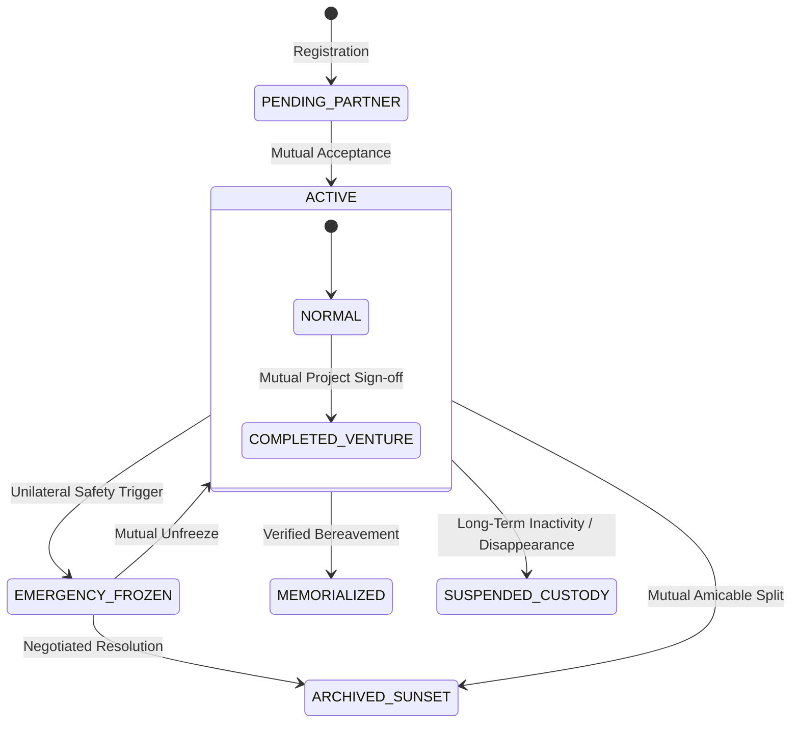

# MYHALF — Duo Lifecycle Transitions & Compassionate Protocols Specification

> **"Two People. One Account. Equal Ownership."**  
> *Architectural handling of human reality: divorce, separation, death, completed ventures, missing partners, and hostile disputes.*

---

## 1. Principles of Compassionate & Resilient Architecture

In conventional single-user platforms, account management is binary: an account exists, or it is deleted.  
In **MYHALF**, a public account represents a shared relationship between two real human beings. Relationships undergo life events:
- Love and marriage may conclude in divorce or separation.
- Life may end for one partner while the other survives in grief.
- Joint creative projects and startups reach natural milestones or conclude.
- Partners may face tragedy: disappearance, kidnapping, political imprisonment, or severe medical incapacitation.
- Toxic or abusive dynamics may emerge, where one party attempts digital extortion or revenge erasure.

A world-class platform must anticipate these scenarios with **cryptographic immutability**, **zero-trust safety**, and **deep human compassion**.

---

## 2. The 6 Lifecycle Transition Protocols

---

### Protocol 1: Amicable Divorce or Separation (الافتراق الودي والطلاق الهادئ)
- **Context:** Two people who shared an account decide to end their relationship amicably.
- **Rules:**
  1. **Dual-Signed Sunset:** Both parties must approve the proposal to transition the account from `ACTIVE` to `ARCHIVED_SUNSET`.
  2. **The "Digital Time-Capsule" (الكبسولة الزمنية المحفوظة):** The account becomes an unalterable, read-only gallery. Neither partner can post new content, delete past memories, or edit captions.
  3. **Equal Vault Data Export:** Both parties receive an identical, complete, cryptographically signed ZIP archive containing all photos, videos, captions, and comments authored by either person.
  4. **Handle Retirement or Mutual Release:** The handle `@handle` can either be retired permanently as a preserved archive, or released if both parties digitally consent.
  5. **Clean Slate Freedom:** Both individuals can freely link their personal credentials to a new duo account in the future with zero residual entanglements.

---

### Protocol 2: Bereavement & Death of a Partner (وفاة أحد أفراد الثنائي)
- **Context:** One partner passes away. The surviving partner carries their grief and shared memories.
- **Rules:**
  1. **Memorialization Mode (`MEMORIALIZED` 🕊️):** Activated upon verified death notice, legal certificate, or verified claim.
  2. **Cryptographic Deceased Lock (القفل التذكاري الأبدي):** All content, posts, and daily answers written by the deceased partner are sealed immutably. **No one**, including the surviving partner, can alter, delete, or overwrite the deceased person's words or perspective.
  3. **The "Surviving Steward" Role (صفة الشريك الحارس):**
     - The surviving partner cannot post as the deceased, nor impersonate them.
     - The surviving partner can post occasional memorial tributes with explicit voice attribution:  
       `[Memorial Tribute: Posted by Omar in loving memory of Sarah]`.
  4. **Duo Legacy Contact (الوصي الرقمي المعتمد):** Couples can optionally designate a trusted third party in advance who receives administrative read-only rights if both partners pass away.

---

### Protocol 3: Hostile Breakup & Anti-Revenge Lock (النزاع العدائي والحماية من الانتقام)
- **Context:** Bitter acrimony, betrayal, domestic abuse, or bad-faith actions where one partner attempts to delete memories, hijack the handle, or post humiliating content.
- **Rules:**
  1. **Instant Unilateral Freeze:** Either co-owner can trigger an immediate freeze with zero approval required from the other.
  2. **Revenge Erasure Immunity (قفل منع مسح الذكريات الانتقامي):** During an active freeze or dispute, neither party can delete posts, wipe the account, or change passwords. Joint assets are placed into a 90-day **Digital Escrow**.
  3. **Co-Owner Silencing:** The internal whisper channel is disconnected immediately to prevent in-app stalking or harassment.
  4. **Confidential Incident Logging:** Safety interventions by one party are concealed from the other's activity feed to safeguard physical welfare.

---

### Protocol 4: Creative & Startup Co-Founders Sunset (انتهاء مشروع أو شراكة عمل)
- **Context:** Two creators, podcast hosts, or startup co-founders who launched a project on MYHALF complete their mission, sell the venture, or move on to separate companies.
- **Rules:**
  1. **"Completed Venture" Hall of Fame (`PROJECT_COMPLETED` 🏆):** The account is converted into a verified portfolio showcase.
  2. **Equal Credit Preservation:** Both founders retain immutable co-creator badges.
  3. **Departure Forwarding:** The profile displays official redirect cards:  
     `"Omar is now building @duo_studio. Sarah is directing @design_pair."`
  4. **Commercial Transfer:** If the brand is acquired by a new team, transfer requires a 4-key handshake (both outgoing founders + both incoming owners).

---

### Protocol 5: Missing Partner, Detention, or Incapacitation (الاختفاء، الاعتقال، الغيبوبة)
- **Context:** A partner goes missing, is politically or unjustly detained, kidnapped, or suffers a severe medical coma. The remaining partner is trapped because dual approval is unavailable.
- **Rules:**
  1. **Dead-Man's Proof of Inactivity:** If a partner's private credential shows zero activity for 180 consecutive days and fails multi-channel cryptographic pings (email, phone, biometric passkeys).
  2. **Duress & Detention Shield (درع الحماية من الإكراه):** If a partner is detained, hostile interrogators or captors cannot force them to alter the account if the free partner outside has already placed the account into an Emergency Freeze.
  3. **Humanitarian Safety Appeal:** The platform provides a secure, encrypted human review workflow where legal guardians, court orders, or power-of-attorney documents can be submitted to prevent account atrophy while strictly upholding privacy.

---

## 3. Invariants & Security Guarantees

| Invariant Code | Guarantee |
| :--- | :--- |
| `INV-LIFE-01` | **No Unilateral Content Deletion:** Neither partner can unilaterally purge joint shared history without mutual consent or an expired dispute window. |
| `INV-LIFE-02` | **Deceased Immutability:** Content authored by a deceased co-owner is cryptographically sealed forever; impersonation is blocked at the protocol layer. |
| `INV-LIFE-03` | **Duress Shield:** An Emergency Freeze initiated by either co-owner overrides all dual-approval requests until mutually resolved. |
| `INV-LIFE-04` | **Equal Vault Parity:** Any data export initiated upon dissolution is delivered identically and fully to both partners. |
